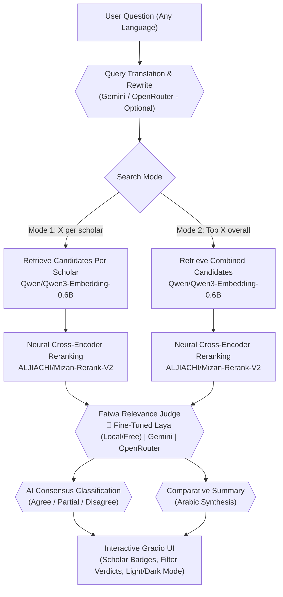

# Fatwa-RAG: Multi-Scholar Islamic Semantic Search & Grounded AI Verification

Semantic search, cross-scholar comparison, and fine-tuned neural relevance verification over **40,000+ fatwas** across major Sunni/Salafi scholars and Saudi scholarly institutions.

[](requirements.txt)
[](LICENSE)
[](https://huggingface.co/ZenoAbderrahim/laya-multilingual-fatwa-relevance)
[](https://huggingface.co/datasets/ZenoAbderrahim/binbaz_fatwas_rag)
[](https://colab.research.google.com/github/AbderrahimZineddineEsi/BinBaz-RAG/blob/multi-sheikh-rag/notebooks/02_run_on_colab.ipynb)


---

## 🌟 What's New: Fine-Tuned Laya Multilingual Fatwa Relevance Judge

The system now integrates our fine-tuned, 322M-parameter multilingual decision model: [**`ZenoAbderrahim/laya-multilingual-fatwa-relevance`**](https://huggingface.co/ZenoAbderrahim/laya-multilingual-fatwa-relevance).

- **100% Free & Local Execution:** Runs directly on local GPU (~30 ms) or CPU (~250–350 ms) via single forward pass. **Zero API keys and zero API costs required.**
- **High Recall (86.4%):** Specifically fine-tuned to eliminate false rejections of authentic rulings.
- **RLCD Distillation:** Distilled from GPT-4o Mini decisions across 950 curated jurisprudence queries and 5,420 balanced training examples.
- **Multi-Provider Choice:** Seamlessly switch between **Fine-Tuned Laya (Local/Free)**, **Google Gemini** (`gemini-2.5-flash`, `gemini-2.5-pro`), and **OpenRouter** (Claude 3.5 Sonnet, GPT-4o, DeepSeek R1, JEV) anytime from the UI Settings.

---

## 🏆 Empirical Benchmark (Held-Out Test Set)

Evaluated head-to-head on **813 held-out, unseen fatwa-question candidate pairs** (stratified 15% test split):

| Model | Training Pool | Overall Accuracy | Positive Recall (`answers-it`) | F1-Score (`answers-it`) | Median Latency | Cost / Key Needed |
| :--- | :--- | :---: | :---: | :---: | :---: | :---: |
| **1. Base Laya (Zero-Shot)** | 0 examples | 61.38% | 27.6% | 0.408 | 29.25 ms | $0.00 / None |
| **2. Previous Laya (3K)** | 3,000 examples (250 Qs) | 81.55% | 68.0% | 0.776 | 30.36 ms | $0.00 / None |
| **3. New Laya (5.4K Balanced)** | **5,420 examples (950 Qs)** | **83.52%** | **86.4%** | **0.835** | 33.59 ms | **$0.00 / None** |
| **Absolute Gain (vs Base)** | — | **+22.14%** | **+58.8%** | **+0.427** | — | — |
| **Absolute Gain (vs 3K)** | — | **+1.97%** | **+18.4%** | **+0.059** | — | — |

### Per-Scholar Accuracy Breakdown (3K vs 5.4K Balanced)

| Scholar / Source | Test Items | Previous 3K Accuracy | New 5.4K Accuracy | Absolute Lift |
| :--- | :---: | :---: | :---: | :---: |
| **Sheikh Ibn Baz** | 301 | 68.4% | **79.7%** | **+11.3%** 🎯 |
| **Sheikh Ibn Uthaymeen** | 158 | 80.4% | 79.1% | -1.3% |
| **Al-Lajnah Ad-Da'imah** | 127 | 89.8% | 83.5% | -6.3% |
| **Sheikh Saleh Al-Fawzan** | 74 | 90.5% | **91.9%** | **+1.4%** |
| **Sheikh Abdullah al-Manee'** | 79 | 98.7% | 94.9% | -3.8% |
| **Sheikh Abdulaziz Aal ash-Sheikh**| 73 | 95.9% | 89.0% | -6.9% |
| **Sheikh Saleh bin Humaid** | 1 | 100.0% | 0.0% | (1 sample) |

> ### 💡 Understanding Positive Recall in Fatwa Search
> **Recall** answers the critical question: *“When an authentic fatwa actually answers the user's specific ruling, does the model detect it?”*
> - In **Base Laya (Zero-Shot)**, recall was only **27.6%**, meaning it falsely discarded over 72% of valid answers!
> - In the **3K Model**, recall was **68.0%** (missing nearly a third of authentic answers).
> - In the **New 5.4K Balanced Model**, recall jumped to **86.4%** (+18.4% boost). It rarely misses a genuine answer, ensuring users find authentic rulings reliably while keeping hard negatives filtered out.

---

## 📚 Multi-Scholar Corpus

The platform indexes over **41,800 fatwas** from authoritative Sunni/Salafi scholars:

| Scholar / Institution | Arabic Name | Fatwa Count |
| :--- | :--- | :---: |
| **Sheikh Abdulaziz ibn Baz** | الشيخ عبد العزيز بن باز | 19,727 |
| **Sheikh Muhammad ibn Saalih al-Uthaymeen** | الشيخ محمد بن صالح العثيمين | 9,119 |
| **Al-Lajnah Ad-Da'imah lil-Ifta (Senior Council)** | اللجنة الدائمة للبحوث العلمية والإفتاء | 9,086 |
| **Sheikh Saleh Al-Fawzan** | الشيخ صالح بن فوزان الفوزان | 1,714 |
| **Sheikh Saleh bin Humaid** | الشيخ صالح بن حميد | 809 |
| **Sheikh Abdulaziz Aal ash-Sheikh** | الشيخ عبد العزيز آل الشيخ | 684 |
| **Sheikh Abdullah al-Manee'** | الشيخ عبد الله المنيع | 684 |
| **Total Indexed Fatwas** | | **41,823** |

---

## 🏗️ System Architecture



### Component Stack

| Layer | Model | Execution Target | API Key Required? |
| :--- | :--- | :--- | :---: |
| **Dense Embedder** | [Qwen/Qwen3-Embedding-0.6B](https://huggingface.co/Qwen/Qwen3-Embedding-0.6B) | GPU / CPU | ❌ No (Local) |
| **Cross-Encoder Reranker** | [ALJIACHI/Mizan-Rerank-V2](https://huggingface.co/ALJIACHI/Mizan-Rerank-V2) | GPU / CPU | ❌ No (Local) |
| **Relevance Judge (Default)** | [ZenoAbderrahim/laya-multilingual-fatwa-relevance](https://huggingface.co/ZenoAbderrahim/laya-multilingual-fatwa-relevance) | GPU / CPU | ❌ No (Local) |
| **Relevance Judge (Alternative)** | Gemini 2.5 Flash, Claude 3.5 Sonnet, GPT-4o-mini | Cloud API | Optional (Gemini/OpenRouter) |
| **Query Rewrite (Optional)** | Gemini or OpenRouter chat models | Cloud API | Optional |
| **Consensus Classification (Optional)**| Gemini, or JEV via OpenRouter Decisions API | Cloud API | Optional |
| **Comparative Summary (Optional)** | Gemini (`gemini-2.5-flash`, `gemini-2.5-pro`) | Cloud API | Optional |

---

## ⚡ Quick Start

### Option A: Run on Google Colab (Recommended)

1. Open [`notebooks/02_run_on_colab.ipynb`](https://colab.research.google.com/github/AbderrahimZineddineEsi/BinBaz-RAG/blob/multi-sheikh-rag/notebooks/02_run_on_colab.ipynb) in Colab.
2. Select **Runtime → Change runtime type → T4 GPU**.
3. (Optional) Set `GEMINI_API_KEY` or `OPENROUTER_API_KEY` in **Colab Secrets** if you want generative summaries.
4. Run all cells. It will launch the Gradio web application with a public `*.gradio.live` link.

### Option B: Run Locally

```bash
# 1. Clone repository
git clone -b multi-sheikh-rag https://github.com/AbderrahimZineddineEsi/BinBaz-RAG.git
cd BinBaz-RAG

# 2. Set up virtual environment
python3 -m venv .venv
source .venv/bin/activate

# 3. Install dependencies
pip install -r requirements.txt

# 4. (Optional) Provide API keys for generative features
cp .env.example .env
# edit .env to add GEMINI_API_KEY or OPENROUTER_API_KEY if desired

# 5. Launch the application
python app.py
```

Open your browser at `http://127.0.0.1:7860`.

> [!NOTE]
> On first launch, `app.py` automatically checks for dataset and embeddings in `data/` and downloads any missing assets directly from Hugging Face Hub ([`ZenoAbderrahim/binbaz_fatwas_rag`](https://huggingface.co/datasets/ZenoAbderrahim/binbaz_fatwas_rag)).

---

## 🛠️ CLI Flags & Hardware Configuration

```bash
python app.py [OPTIONS]
```

| Flag | Default | Description |
| :--- | :--- | :--- |
| `--embedder-device` | `cpu` | Device for Qwen 0.6B (`cpu`, `cuda`, `auto`). |
| `--reranker-device` | `auto` | Device for Mizan Reranker (`auto`, `cuda`, `cpu`). |
| `--judge-device` | `auto` | Device for Laya Judge (`auto`, `cuda`, `cpu`). |
| `--data-dir` | `./data` | Directory containing cleaned CSVs and embeddings. |
| `--no-download` | `off` | Skip automatic Hugging Face asset downloads. |
| `--no-warmup` | `off` | Skip initial startup warmup inference. |
| `--host` | `127.0.0.1` | Server bind host. |
| `--port` | `7860` | Server listening port. |
| `--share` | `off` | Generate a temporary public Gradio share link. |
| `--no-browser` | `off` | Prevent automatic browser launch on startup. |

---

## 🔬 Dataset & Fine-Tuning Methodology

The fine-tuning pipeline is fully documented and reproducible via our modular notebooks:

### 1. Data Generation & Distillation
- **950 Curated Jurisprudence Questions**:
  - `data/250_fatwa_relevance_questions.csv` (250 questions, broad coverage)
  - `data/500_fatwa_relevance_questions.csv` (500 questions, deep niche fiqh topics)
  - `data/200_big3_questions.csv` (200 high-yield questions for Ibn Baz, Ibn Uthaymeen, Al-Lajnah)
- **Hard Negative Mining**: Retrieved candidate pools scored with Mizan Reranker V2; candidates with top reranker scores that touched related topics but did not directly answer the query were mined as hard negatives.
- **LLM Teacher Distillation**: Labeled with GPT-4o Mini using calibrated confidence scores and verified verdicts.
- **5,420 Balanced Dataset**: Balanced with 2,606 authentic positives (`answers-it`, 48.1%) and 2,814 hard negatives (`does-not-answer`, 51.9%).

### 2. Notebooks
- **[`notebooks/01_kaggle_dataset_generation_and_labeling_6k_balanced.ipynb`](notebooks/01_kaggle_dataset_generation_and_labeling_6k_balanced.ipynb)**: Assembles the 950 questions, generates multi-scholar candidates, runs GPT-4o Mini labeling, and exports the balanced bundle.
- **[`notebooks/02_kaggle_laya_eval_and_finetune_9k.ipynb`](notebooks/02_kaggle_laya_eval_and_finetune_9k.ipynb)**: Runs zero-shot evaluation, distributed multi-GPU training (DDP / torchrun), held-out test evaluation, and uploads weights to Hugging Face.
- **[`notebooks/02_run_on_colab.ipynb`](notebooks/02_run_on_colab.ipynb)**: One-click notebook to run the full application with T4 GPU acceleration on Google Colab.

---

## 📜 License & Scholarly Disclaimer

- **License:** MIT License ([LICENSE](LICENSE)).
- **Disclaimer:** This software is an informational semantic retrieval and research aid. Fatwas and AI-generated syntheses must always be cross-referenced against original scholarly sources and verified by qualified persons of knowledge.
