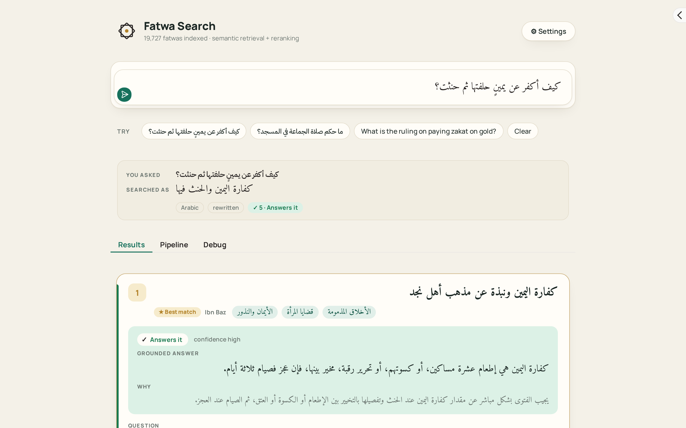
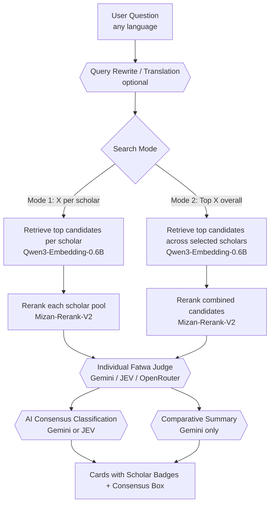

# Fatwa-RAG: Multi-Scholar Islamic Semantic Search & AI Synthesis

Semantic search, cross-scholar comparison, and AI-judged answers over **40,000+ fatwas** across major Sunni/Salafi scholars and Saudi scholarly institutions.

[](requirements.txt)
[](LICENSE)
[](https://huggingface.co/datasets/ZenoAbderrahim/binbaz_fatwas_rag)
[](https://colab.research.google.com/github/AbderrahimZineddineEsi/BinBaz-RAG/blob/main/notebooks/02_run_on_colab.ipynb)



## What it does

- **Multi-scholar corpus:** Indexes over 40,000 fatwas from trusted Sunni/Salafi scholars:
  - **Sheikh Abdulaziz ibn Baz** (19,727 fatwas)
  - **Sheikh Muhammad ibn Saalih al-Uthaymeen** (9,119 fatwas)
  - **Al-Lajnah Ad-Da'imah lil-Ifta / Council of Senior Scholars in Saudi Arabia** (9,086 fatwas)
  - **Sheikh Saleh Al-Fawzan** (1,714 fatwas)
  - Additional senior Saudi scholars: Sheikh Abdulaziz Aal ash-Sheikh, Sheikh Abdullah al-Manee', Sheikh Saleh bin Humaid.
- **Two Distinct Search Modes:**
  1. **X answers per scholar:** Searches each scholar's dataset independently, guaranteeing balanced, direct representation from each selected sheikh.
  2. **Top X answers overall:** Ranks all candidate fatwas across selected scholars into a single global shortlist.
- **Dynamic Scholar Selector:** Easily pick which scholars or institutions are included in any query.
- **Prominent Scholar Attribution:** Every fatwa card clearly and prominently displays which Sheikh issued the fatwa.
- **Two-stage retrieval:** Query encoding via `Qwen/Qwen3-Embedding-0.6B` and candidate reranking via `ALJIACHI/Mizan-Rerank-V2`.
- **AI Verdict per fatwa:** Optional LLM step labels each fatwa *Answers it*, *Related only*, or *Unrelated* and quotes the grounded excerpt.
- **NEW — AI Consensus Classification:** Evaluates whether the retrieved scholars agree on the ruling (*Agree*, *Partially Agree*, or *Disagree*), runnable via **Gemini** or **JEV** (`typesafe/jev-*`).
- **NEW — Comparative Summary (Gemini):** An objective Arabic synthesis explaining the positions and rulings of the scholars on the question.

## Quick start

```bash
git clone https://github.com/AbderrahimZineddineEsi/BinBaz-RAG.git
cd BinBaz-RAG
python -m venv .venv && source .venv/bin/activate
pip install -r requirements.txt
cp .env.example .env      # optional: add GEMINI_API_KEY / OPENROUTER_API_KEY
python app.py
```

Open the printed URL (default `http://127.0.0.1:7860`).

The app automatically detects whether multi-scholar embeddings (`data/multi_scholar_clean.csv` + `data/qwen3_06b_multi_scholar_embeddings.pt`) are present, or falls back seamlessly to the base Bin Baz corpus (`data/binbaz_clean.csv` + `data/qwen3_06b_title_answer_embeddings.pt`).

## How it works



| Role | Model | Execution Target |
| --- | --- | --- |
| Embedder | [Qwen/Qwen3-Embedding-0.6B](https://huggingface.co/Qwen/Qwen3-Embedding-0.6B) | CPU (default) or GPU |
| Reranker | [ALJIACHI/Mizan-Rerank-V2](https://huggingface.co/ALJIACHI/Mizan-Rerank-V2) | GPU (default) or CPU |
| Query Rewrite (optional) | Gemini, or any OpenRouter chat model | Cloud API |
| Fatwa Judge (optional) | Gemini, JEV (`typesafe/jev-1.13`), or OpenRouter chat | Cloud API |
| Consensus Classification (optional) | Gemini, or JEV via OpenRouter Decisions API | Cloud API |
| Comparative Summary (optional) | Gemini (`gemini-2.5-flash`, `gemini-3.5-flash`) | Cloud API |

## Notebooks

The pipeline is split into clean, modular notebooks:

1. **[`notebooks/01_clean_multi_scholar_datasets.ipynb`](notebooks/01_clean_multi_scholar_datasets.ipynb):**
   Loads raw JSON scrapings, performs text cleaning, fixes metadata issues (e.g. category-embedded titles in Uthaymeen, portal breadcrumbs in Al-Lajnah Ad-Da'imah), filters empty records, and outputs standardized per-scholar CSVs as well as the master `multi_scholar_clean.csv`.
2. **[`notebooks/02_build_embeddings_kaggle.ipynb`](notebooks/02_build_embeddings_kaggle.ipynb):**
   Runnable on Kaggle with 2x T4 GPU accelerator. The first cell provides full instructions for uploading `multi_scholar_clean.csv`, computing multi-GPU embeddings with `Qwen3-Embedding-0.6B`, and downloading the output package.
3. **[`notebooks/03_run_multi_scholar_rag.ipynb`](notebooks/03_run_multi_scholar_rag.ipynb):**
   End-to-end runnable demonstration of the multi-scholar search pipeline (both Mode 1 and Mode 2), AI judging, consensus classification (Gemini/JEV), and comparative summary generation.
4. **[`notebooks/01_build_corpus_and_embeddings_kaggle.ipynb`](notebooks/01_build_corpus_and_embeddings_kaggle.ipynb):**
   Legacy single-scholar (Bin Baz) embedding pipeline notebook.

## Configuration & CLI Flags

| Flag | Default | Meaning |
| --- | --- | --- |
| `--data-dir` | `./data` | Folder with cleaned CSVs and precomputed `.pt` embeddings. |
| `--no-download` | off | Do not fetch missing base data files from Hugging Face. |
| `--embedder-device` | `cpu` | `cpu`, `cuda` or `auto`. |
| `--reranker-device` | `auto` | `auto`, `cuda` or `cpu`. |
| `--no-warmup` | off | Skip the startup warmup query. |
| `--host` / `--port` | `127.0.0.1` / `7860` | Bind address and port. |
| `--share` | off | Create a temporary public `*.gradio.live` link. |
| `--no-browser` | off | Do not open a browser tab automatically. |

## License & Disclaimer

- **License:** MIT License ([LICENSE](LICENSE)).
- **Disclaimer:** This software is a research and search tool. AI verdicts and summaries are machine-generated and must be verified against the original fatwa texts.
