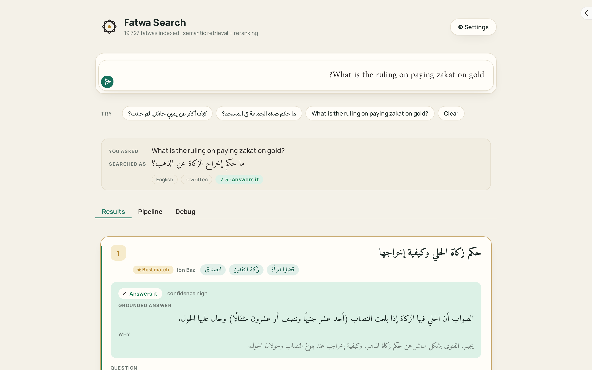
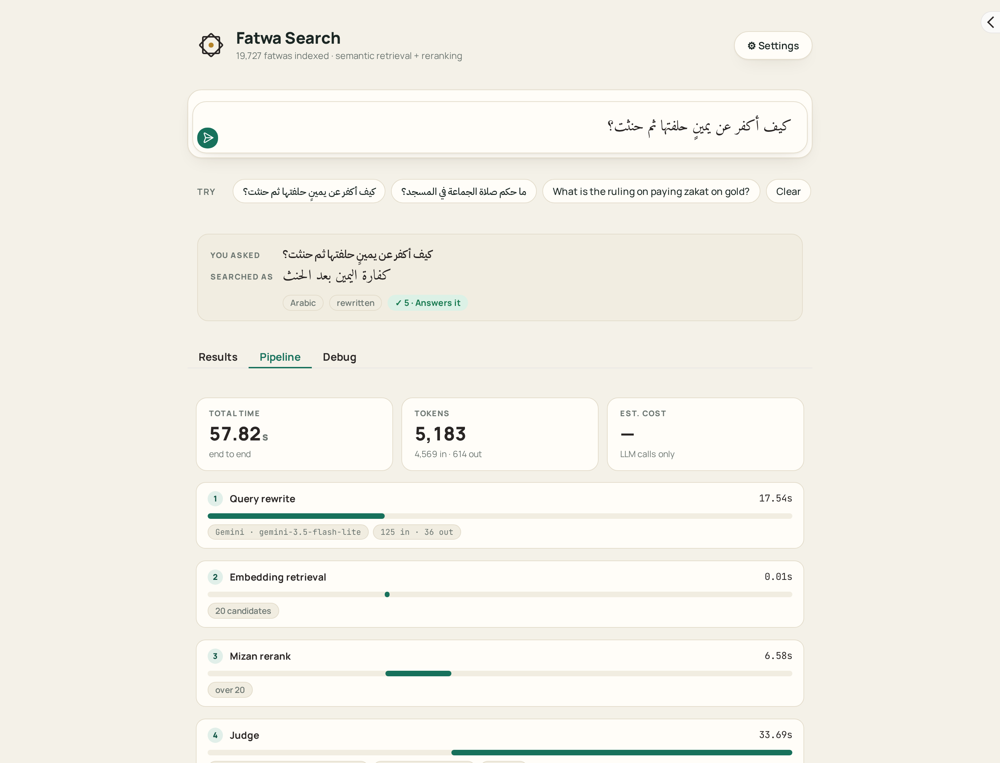
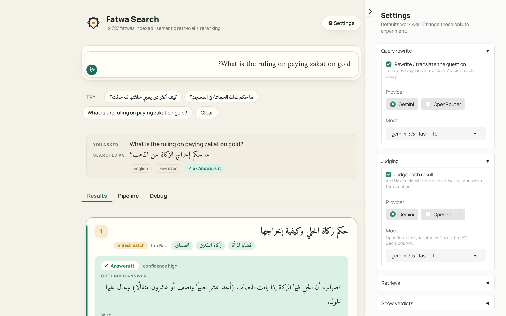

# BinBaz-RAG

Semantic search and AI-judged answers over 19,727 fatwas of Sheikh Ibn Baz.

[](requirements.txt)
[](LICENSE)
[](https://huggingface.co/datasets/ZenoAbderrahim/binbaz_fatwas_rag)
[](https://colab.research.google.com/github/AbderrahimZineddineEsi/BinBaz-RAG/blob/main/notebooks/02_run_on_colab.ipynb)


## What it does

- **Ask in Arabic or any other language.** An optional LLM step rewrites the question into a clean Arabic search query.
- **Two-stage retrieval.** Qwen3-Embedding finds 20 candidates by cosine similarity, then the Arabic reranker Mizan-Rerank-V2 orders them.
- **Optional verdict per fatwa.** An LLM marks each result *Answers it*, *Related only* or *Unrelated* and quotes the part that answers.
- **The full fatwa**, with a link to the original page on binbaz.org.sa.

## Quick start

```bash
git clone https://github.com/AbderrahimZineddineEsi/BinBaz-RAG.git
cd BinBaz-RAG
python -m venv .venv && source .venv/bin/activate
pip install -r requirements.txt
cp .env.example .env      # optional, see "API keys"
python app.py
```

Open the printed URL (default http://127.0.0.1:7860).

On the first run the app downloads about 143 MB of data from the [Hugging Face dataset](https://huggingface.co/datasets/ZenoAbderrahim/binbaz_fatwas_rag) into `data/`, plus the two models from the Hugging Face Hub (about 1.2 GB each, so roughly 2.5 GB in total). Later runs start from the cache.

## Screenshots

An English question is rewritten to Arabic (`ما حكم إخراج الزكاة عن الذهب؟`) and all five results are judged *Answers it*; the best match is `حكم زكاة الحلي وكيفية إخراجها`. In this run the whole pipeline took 26.71 s, of which the Mizan rerank was 3.48 s on a GTX 1050.



The Pipeline tab shows per-step time and token use. Here the Arabic question `كيف أكفر عن يمينٍ حلفتها ثم حنثت؟` took 57.82 s end to end: rewrite 17.54 s, retrieval 0.01 s, rerank 6.58 s, judge 33.69 s, 5,183 tokens. Most of the time is LLM latency, which varied a lot between runs (the same query took 27.77 s in another run).



Providers, models, retrieval sizes and the verdict filter are all adjustable in Settings.



More real runs, including Colab and JEV-judge runs, are in [examples/](examples/README.md).

## How it works


| Role | Model | Where it runs by default |
| --- | --- | --- |
| Embedder | [Qwen/Qwen3-Embedding-0.6B](https://huggingface.co/Qwen/Qwen3-Embedding-0.6B) | CPU |
| Reranker | [ALJIACHI/Mizan-Rerank-V2](https://huggingface.co/ALJIACHI/Mizan-Rerank-V2) | GPU if available |
| Rewrite (optional) | Gemini, or any OpenRouter chat model | API |
| Judge (optional) | Gemini, a JSON-mode OpenRouter model, or JEV (`typesafe/jev-1.13`) via OpenRouter | API |

The design choices and their reasons are in [docs/architecture.md](docs/architecture.md).

## API keys (optional)

| Key | Unlocks |
| --- | --- |
| none | Retrieval and reranking. Rewrite and judge start switched off. |
| `GEMINI_API_KEY` | Gemini rewrite and judge ([get a key](https://aistudio.google.com/apikey)). |
| `OPENROUTER_API_KEY` | OpenRouter rewrite, OpenRouter chat judges and the JEV judge ([get a key](https://openrouter.ai/keys)). |

Put them in `.env` (copy `.env.example`) or export them. Without a Gemini key, rewrite and judge are off by default; you can still switch them to OpenRouter in Settings.

## Hardware

- **Tested:** a laptop-class PC with an i5 and a GTX 1050 (3 GB), with the embedder on CPU and the reranker on GPU, and Colab GPU runs. The Mizan rerank of 20 candidates took 3.5 to 6.6 s locally and about 1.5 s on Colab.
- **CPU only works:** pass `--reranker-device cpu`. On the same machine the rerank of 20 candidates took 33 to 35 s per query (measured, Python 3.12).
- **Older GPUs:** the default PyTorch wheels are built for compute capability 7.5 and newer. A GTX 1050 (6.1) needs a build that still includes older kernels, for example `pip install torch --index-url https://download.pytorch.org/whl/cu126`.
- **Python:** tested on 3.12 and 3.14.
- `transformers` is pinned below 5 because Mizan's remote code breaks on 5.x.

## Configuration

| Flag | Default | Meaning |
| --- | --- | --- |
| `--data-dir` | `./data` | Folder with the three data files. |
| `--no-download` | off | Do not fetch missing data files from Hugging Face. |
| `--embedder-device` | `cpu` | `cpu`, `cuda` or `auto`. |
| `--reranker-device` | `auto` | `auto`, `cuda` or `cpu`. |
| `--no-warmup` | off | Skip the startup warmup query. |
| `--host` / `--port` | `127.0.0.1` / `7860` | Bind address and port. |
| `--share` | off | Create a temporary public `*.gradio.live` link. |
| `--no-browser` | off | Do not open a browser tab. |

| Environment variable | Meaning |
| --- | --- |
| `FATWA_DATA_DIR` | Default for `--data-dir`. |
| `FATWA_DATA_REPO` | Hugging Face dataset to download from (default `ZenoAbderrahim/binbaz_fatwas_rag`). |
| `FATWA_ENV_FILE` | Path to an extra `.env` file to load. |

## Evaluation

A small test on 30 random fatwas (n = 30, so differences of a few points are noise):

| | Embedder only | After rerank |
| --- | --- | --- |
| Source fatwa in top 5 (exact) | 53% | 57% |
| Any top-5 result answers the question (LLM-judged) | | 90% |
| Same, with LLM-rewritten queries | | 73% |

Details and caveats are in [docs/architecture.md](docs/architecture.md#4-evaluation).

## Project structure

```text
├── app.py                  # the whole app: retrieval, rerank, LLM steps, Gradio UI
├── requirements.txt
├── .env.example
├── data/                   # downloaded on first run (git-ignored)
├── notebooks/
│   ├── 01_build_corpus_and_embeddings_kaggle.ipynb
│   ├── 02_run_on_colab.ipynb
│   └── 03_retrieval_evaluation_kaggle.ipynb
├── docs/
│   ├── architecture.md
│   └── images/
└── examples/               # saved runs (PDF) and an index
```

## Rebuilding the data

Notebook [01](notebooks/01_build_corpus_and_embeddings_kaggle.ipynb) cleans the raw Kaggle dataset and embeds `title + answer` with Qwen3-Embedding-0.6B. It was run on Kaggle with 2 × T4 GPUs. Copy its three outputs into `data/`.

## Disclaimer

This is a research and search tool, not a fatwa authority. Verdicts and answers shown by the LLM steps are machine-generated and can be wrong. Always read the original fatwa through its link.

## Acknowledgements

- The fatwa text is from [binbaz.org.sa](https://binbaz.org.sa), via the Kaggle dataset by `a5medashraf` ([bin-baz-fatwas-dataset](https://www.kaggle.com/datasets/a5medashraf/bin-baz-fatwas-dataset)), itself based on [Alsarmad/binbaz_database](https://github.com/Alsarmad/binbaz_database).
- [Qwen3-Embedding](https://huggingface.co/Qwen/Qwen3-Embedding-0.6B) by the Qwen team.
- [Mizan-Rerank-V2](https://huggingface.co/ALJIACHI/Mizan-Rerank-V2) by ALJIACHI.
- [JEV](https://openrouter.ai) judge models (`typesafe/jev-*`) served through OpenRouter.

## License

Code: [MIT](LICENSE). The fatwa content belongs to its original publisher; see the dataset card for attribution.
