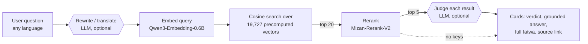

# Architecture

How the fatwa search works, and why it is built this way. About a five-minute read.

## 1. Overview

A query goes through four stages. Only the retrieval and rerank stages are required; the two LLM stages are optional and need an API key.

| Stage | What it does | Default model |
| --- | --- | --- |
| Rewrite (optional) | Turns any language into a clean Arabic search query. Mizan is Arabic-only, so this is what makes English questions work. | `gemini-3.5-flash-lite` |
| Retrieve | Encodes the query and takes the 20 nearest fatwas by cosine similarity. | `Qwen/Qwen3-Embedding-0.6B` |
| Rerank | A cross-encoder re-scores each (query, fatwa) pair and orders the 20 candidates. | `ALJIACHI/Mizan-Rerank-V2` |
| Judge (optional) | An LLM labels each shown result `answers-it`, `related-only` or `unrelated`, with a short grounded answer. | Gemini, or JEV via OpenRouter |

Everything is configurable from the Settings panel: providers and models per task, how many to retrieve, rerank and show, and which verdicts to display.

## 2. Data

- **Source:** the fatwas of Sheikh Ibn Baz from [binbaz.org.sa](https://binbaz.org.sa), through a public Kaggle scrape (`a5medashraf/bin-baz-fatwas-dataset`).
- **Size:** 19,727 fatwas, 215 distinct category tags. Each row has a title, a question, an answer, categories and a link to the original page.
- **Cleaning:** NFKC normalization, removal of scraping artifacts (HTML entities, footnote markers, zero-width characters). There is deliberately no stemming, stopword removal or diacritic stripping, because that hurts transformer embedders.
- **Encoding postmortem:** an early loader tried several encodings in a loop and let a CSV parse error silently fall through to the wrong legacy encoding, which produced mojibake in titles. The loader now tries plain UTF-8 first, then widens a `charset_normalizer` scan, with `ftfy` as a safety net, and prints a data-loss count.
- **Multi-scholar ready:** every row has a `source` column (`Ibn Baz`), so other scholars can be added to the same index and filtered at query time.

The cleaned corpus and embeddings are published as a [Hugging Face dataset](https://huggingface.co/datasets/ZenoAbderrahim/binbaz_fatwas_rag) and downloaded on first run. Notebook 01 rebuilds them.

## 3. Design decisions

**No chunking.** Token lengths were measured with the Qwen3 tokenizer on `title + answer`: mean 337, median 230, 75th percentile 407, maximum 7,550. The longest fatwa fits inside the 8,192-token context of both models, so splitting was not needed. Embedding and reranking are capped at 1,024 tokens, which covers 95.6% of fatwas whole; the other 864 are truncated for embedding only. The full answer is always kept and displayed. The first version of this project (BGE-M3 with sentence-boundary chunks) was dropped for this reason.

**`title + answer` is the retrieval unit.** The text that is embedded and reranked is `title + " — " + answer`. The title is a short canonical summary that anchors the topic, and the answer carries the content. The question field is sometimes long and narrative, so it is shown in the results but not embedded.

**Embedder on CPU, reranker on GPU.** The corpus embeddings are precomputed, so only the query needs encoding, which is cheap on CPU (about 0.7 s per query measured in the model-selection experiments). That leaves the GPU to the reranker. On a 3 GB GTX 1050 the two models do not fit together, but the reranker alone peaks at about 2.2 GB of VRAM with `max_length=1024` and `batch_size=16`. Both can run on one big GPU, as in the Colab notebook.

**Brute-force cosine search, no vector database.** At 19,727 × 1,024 floats (about 80 MB) a single matrix-vector product takes milliseconds. A vector database would add a dependency and nothing else at this scale.

**An LLM judge instead of a score threshold.** Reranker scores are not calibrated: in the saved runs the top five often score 0.95 to 0.97 whether or not they answer the question. A fixed cutoff would be arbitrary, so the app asks a small LLM whether each result actually answers the question and shows the verdict next to it.

**JEV through the OpenRouter Decisions API.** `typesafe/jev-*` models are judges that return a typed choice with probabilities rather than free text. They are cheap (about $0.0002 to $0.0003 for five judged fatwas in the saved runs) and fast (0.3 to 1.2 s). Other OpenRouter and Gemini models judge through a JSON-schema prompt instead.

## 4. Evaluation

A small benchmark on 30 randomly sampled fatwas (seed 42), run on Kaggle in notebook 03. For each, the question field is the query. Retrieval takes the top 20 and the reranker keeps the top 5.

- **Exact:** the source fatwa itself (its `fatwa_id`) appears in the results.
- **Semantic:** an LLM judge (`gemini-3.5-flash-lite`) says at least one of the top results answers the question, even if it is a different fatwa. This matters because the corpus has many near-duplicate fatwas.
- **Rewritten:** the same two tests after an LLM paraphrased each query.

| Test | Metric | Embedder only | After rerank |
| --- | --- | --- | --- |
| Original, exact | Recall@1 | 0.333 | 0.367 |
| | Recall@5 | 0.533 | 0.567 |
| | MRR | 0.411 | 0.443 |
| Original, semantic | success@1 / @3 / @5 | | 0.667 / 0.833 / 0.900 |
| Rewritten, exact | Recall@1 | 0.267 | 0.300 |
| | Recall@5 | 0.500 | 0.467 |
| | MRR | 0.367 | 0.388 |
| Rewritten, semantic | success@1 / @3 / @5 | | 0.600 / 0.733 / 0.733 |

How to read this, honestly:

- **n = 30.** One query is 3.3 percentage points, so differences of a few points are noise. Treat these as a sanity check, not a benchmark.
- Exact recall understates quality: 90% of queries get at least one result in the top 5 that the judge says answers the question, but only 57% get the exact source fatwa, because similar fatwas compete.
- The reranker helps a little on the top ranks (MRR 0.411 → 0.443).
- Rewriting the queries with an LLM **lowered** scores in this sample (semantic success@5 0.900 → 0.733). One plausible reason is that the queries were already Arabic questions, so a rewrite had little to fix; with n = 30 this is a hypothesis, not a finding. The rewrite step is meant for non-Arabic input, which this test did not cover.

## 5. History

- **v1:** `BAAI/bge-m3` with separate title, question and chunk indexes, and `bge-reranker-v2-m3`. Superseded once the token statistics showed chunking was unnecessary.
- **Earlier baselines:** TF-IDF, MiniLM, Arabic-SBERT, AraBERT and E5 were tried and dropped; TF-IDF was weak because it only matches overlapping words.
- **v2 (this repo):** one `title + answer` unit, Qwen3-Embedding-0.6B for retrieval and the Arabic-specialised Mizan-Rerank-V2 for reranking. Qwen3-Embedding-8B was ruled out because its CPU query latency and memory footprint are impractical for local use.
- **Embedder choice:** Qwen3-Embedding-0.6B over BGE-M3 was chosen despite higher CPU query latency (about 0.7 s against 0.3 s), which was judged tolerable.

## 6. Roadmap

- **Multi-scholar `source` filter:** add other scholars to the same index and let the user restrict a search to chosen ones.
- **No-answer fallback:** if the judge finds no answering fatwa in the shortlist, re-query once with a rewrite informed by why the first attempt failed, possibly with a stronger model since this path is rare.
- **Larger evaluation:** a bigger, hand-labelled set, and calibrating the judge so `answers-it` filtering can be on by default.

## Notes on dependencies

`transformers` is pinned below 5: Mizan-Rerank-V2 ships remote code that calls `get_extended_attention_mask`, which transformers 5.x removed (verified failing on 5.20.2, working on 4.57.6). On GPUs older than compute capability 7.5, such as the GTX 1050, install a PyTorch build that still includes those kernels (for example the CUDA 12.6 wheels); the default CUDA 13 wheels do not.
